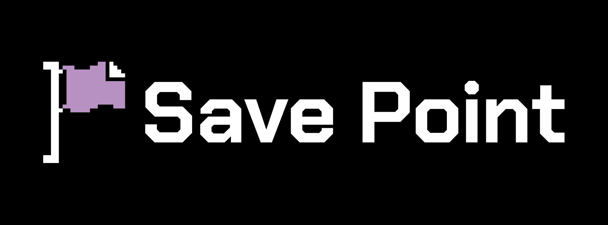

<p align="center">
  <a href="https://savepoint.co.nz"></a>
</p>

<h1 align="center">MemeLine</h1>

<p align="center">
  A community site and app for memes: post, vote, discuss, and see when each meme took off alongside the world events of the time.<br>
  Built and owned by <a href="https://savepoint.co.nz"><b>Save Point Limited</b></a>, New Zealand.
</p>

<p align="center">
  <a href="app/README.md">App</a> ·
  <a href="app/docs/plan.md">Plan</a> ·
  <a href="legal/README.md">Legal</a> ·
  <a href="docs/">Legacy docs</a> ·
  <a href="SECURITY.md">Security</a> ·
  <a href="LICENSE">Licence</a>
</p>

---

> [!IMPORTANT]
> MemeLine is in development and is Save Point's proprietary software. It is **not** open source; see [LICENSE](LICENSE). The legal documents in [legal/](legal/README.md) are drafts and haven't had legal review yet.

## What it does

The website, iOS app and Android app are one **Expo Router** codebase in [`app/`](app/README.md), backed by **Firebase**.

- **🗳️ Community posts.** Anyone can read. Signed-in users post memes publicly, vote them up or down and comment.
- **🕰️ Timeline.** Memes and world events by year. Every post can link to a meme on the timeline.
- **📚 Personal library.** Save photos, videos, links and text notes, star favourites and sort them into folders. The library syncs to your account.
- **🔐 Sign in with Apple or Google.** No passwords to manage.

The full product plan, including the Firestore data model and Cloud Functions, is in [app/docs/plan.md](app/docs/plan.md).

## Project layout

```
MemeLine/
├── app/                    # The MemeLine site and apps (Expo Router + Firebase)
│   ├── src/                # app/ routes, components/, constants/, data/, db/, lib/
│   ├── assets/             # Images and fonts for the app
│   ├── docs/plan.md        # Product plan and roadmap
│   ├── app.json            # Expo config
│   └── package.json
├── legal/                  # Terms of use, privacy policy, community guidelines (drafts)
├── memeline/               # Legacy Raspberry Pi app (Python + Tkinter + VLC)
│   ├── importers/          # TikTok export importer, yt-dlp downloader
│   ├── ui/                 # Gallery, viewer, add-media screens
│   └── config.py  db.py  thumbnails.py
├── scripts/                # Legacy CLIs: import, download, rebuild thumbnails
├── pi-setup/               # Legacy: xinitrc + systemd unit to boot into the app
├── docs/                   # Legacy Pi app docs
├── assets/fonts/           # Chakra Petch + Figtree
├── *.stl                   # 3D-printed touchscreen enclosure parts
├── main.py                 # Legacy app entry point
├── requirements.txt
├── LICENSE                 # Proprietary, all rights reserved
└── SECURITY.md
```

`data/` (the legacy app's database, media and thumbnails) and every `.env*` file are git-ignored.

## Quick start (Save Point staff)

```sh
cd app
npm install
npx expo start          # then scan the QR code with a development build
npx expo run:android    # local Android build (needs Android Studio / an emulator)
npx eas-cli@latest build --profile development --platform ios   # iOS, built in the cloud
```

The app uses native modules, so it needs a development build rather than Expo Go. Before committing, run `npx tsc --noEmit` and `npx expo lint`.

## Legal

The source text for the public pages the app links to:

- [Privacy Policy](legal/privacy-policy.md)
- [Terms of Use](legal/terms-of-use.md)
- [Community Guidelines](legal/community-guidelines.md)

See [legal/README.md](legal/README.md) for what has to happen before launch.

## Legacy: the Raspberry Pi app

MemeLine started as an offline touchscreen media browser for a Raspberry Pi 3B+ with the official Pi Touch Display 2, in a 3D-printed case. That Python code is in the repo root. It's kept for reference and isn't part of the new product.

It holds saved TikTok videos (Likes, Favorites, Posts, Reposts), imported from TikTok's "Download your data" export, plus photos, videos and text notes you add yourself. Everything plays offline from local files. Built with Python 3.12, Tkinter, libVLC, yt-dlp and SQLite.

<details>
<summary><b>Legacy docs, quick start and layout</b></summary>

### Documentation

| Doc | What's in it |
|---|---|
| [docs/architecture.md](docs/architecture.md) | Components, data flow, and why each technology was chosen |
| [docs/data-model.md](docs/data-model.md) | Database schema column by column, the status lifecycle, on-disk layout, in-memory data structures and the reasons for each |
| [docs/tiktok-pipeline.md](docs/tiktok-pipeline.md) | Importing the export, how the parser classifies it, downloading, failure types and what was done about them |
| [docs/ui.md](docs/ui.md) | Screens, navigation, styling tokens and fonts, input handling |
| [docs/raspberry-pi.md](docs/raspberry-pi.md) | Hardware, OS packages, display setup, booting into the app |
| [docs/known-issues.md](docs/known-issues.md) | Current limitations and bugs, ordered by impact |

### Quick start (dev machine)

```sh
python3 -m venv .venv
.venv/bin/pip install -r requirements.txt
mkdir -p ~/.local/share/fonts && cp assets/fonts/*.ttf ~/.local/share/fonts/ && fc-cache -f

.venv/bin/python scripts/import_tiktok.py path/to/user_data_tiktok.json
.venv/bin/python scripts/download_pending.py
.venv/bin/python main.py
```

System packages needed: `python3-tk`, `vlc` (libVLC) and, optionally, `ffmpeg`. Downloads need yt-dlp's `curl-cffi` extra, which `requirements.txt` already includes.

### Repository layout

```
main.py                       entry point -> memeline.ui.app.main()
memeline/
  config.py                   paths, screen size, fullscreen flag, collection tabs
  db.py                       SQLite schema + every query
  thumbnails.py               save_thumbnail(): shrink an image to tile size
  importers/
    tiktok_export.py          export JSON -> row dicts (classifies Likes/Favorites/...)
    downloader.py             yt-dlp wrapper: pending rows -> files on disk
  ui/
    app.py                    main window, nav bar, screen switching
    gallery.py                scrollable thumbnail grid
    viewer.py                 VLC video / image / text viewer with prev/next
    add_media.py              add your own files or text notes
    style.py                  brand colours, fonts, button factory
scripts/
  import_tiktok.py            CLI for the importer
  download_pending.py         CLI for the downloader (--retry-failed, cookies)
  rebuild_thumbnails.py       one-off: shrink old full-size thumbnails
pi-setup/
  xinitrc                     minimal X session that runs the app
  memeline.service            systemd unit to boot into it
assets/fonts/                 Chakra Petch + Figtree (install with fc-cache)
docs/                         see the table above
*.stl                         enclosure parts (back, back v2, top, hinge)
data/                         git-ignored: memeline.db, media/, thumbnails/, covers/
```

### Status (2026-10-17)

- **Library:** 5,840 videos downloaded (4,941 Likes, 899 Favorites), about 25 GB. 856 couldn't be downloaded and are hidden. Most are region-locked from NZ; the rest were removed or are expired own-Post links. Details in [docs/tiktok-pipeline.md](docs/tiktok-pipeline.md#what-failed-and-why-2026-10-runs).
- **App:** runs on the dev machine. Not yet tried on the Pi or touchscreen.
- **Gallery:** only draws what's on screen. "All" (5,840 items) opens in about 0.4 s on the dev machine.
- **Before deploying to the Pi**, read [docs/raspberry-pi.md](docs/raspberry-pi.md) and [docs/known-issues.md](docs/known-issues.md). The service setup and display rotation are untested.

</details>

## Ownership

**MemeLine** is © 2026 Save Point Limited, a New Zealand company (company number 9392145). All rights reserved.

- Website: [savepoint.co.nz](https://savepoint.co.nz)
- General enquiries: [contact@savepoint.co.nz](mailto:contact@savepoint.co.nz)
- Support, privacy and security: [support@savepoint.co.nz](mailto:support@savepoint.co.nz)

"Save Point" and the Save Point flag logo are the property of Save Point Limited. Memes and media shown in MemeLine belong to their respective creators. Apple, Google, TikTok and Firebase are trademarks of their respective owners. This project is not affiliated with or endorsed by any of them.
